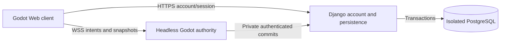

# ADR 007 — Authority, accounts and durable progress for the V2 slice

Status: accepted implementation direction, 2026-10-14; services are not deployed.
Supersedes: ADR 004's provisional runtime boundary, not its hosting isolation rules.
Authorization: developer requested P1 and explicitly confirmed one character per
account, two-client validation and a personal quest beer. Operational launch
choices in Spec 020 D4 remain open. No external/model reviewer is claimed.

## Architecture decision

One headless Godot process owns the initial zone simulation; a small Python/Django
service owns accounts and transactional persistence in the isolated PostgreSQL
database. Reuse Django's account, session, password and migration facilities rather
than implementing password/session storage in GDScript. Choose/pin a supported
Django release and its dependencies at P4; this ADR installs none.

The browser uses same-origin HTTPS for accounts and WSS for gameplay through Caddy.
Only Django connects to PostgreSQL. The Godot authority calls a private authenticated
service API for load/commit; private routes are not exposed by the public proxy.
Use separate runtime/migration credentials, not the bootstrap database administrator.
Keep one application for account and persistence responsibilities, not separate
microservices per domain. No Redis, broker, sharding or orchestration framework.

Godot documents native/Web WebSocket support and its TCP latency tradeoff.
We select it for this small shared exploration slice, not as a latency guarantee
for multiplayer surf. Web remains single-threaded Compatibility. See official
[WebSocket](https://docs.godotengine.org/en/stable/tutorials/networking/websocket.html)
and [Web export](https://docs.godotengine.org/en/stable/tutorials/export/exporting_for_web.html)
documentation. Reconsider transport only if measured P6 interaction latency fails.

## Account/session boundary

- Email and password registration/login; one character per account, enforced by
  a database uniqueness constraint. Display name is separate from account identity.
  Creation validates name length/content and every appearance ID before committing.
- Use Django session authentication. Web session cookies are Secure, HttpOnly and
  SameSite; state-changing HTTPS calls require CSRF validation and allowed Origin.
  Login rotates the session; logout/password reset revoke it and game access.
  Use a small Web fetch adapter via JavaScriptBridge with same-origin credentials;
  do not assume HttpOnly cookies can be read or arbitrary headers added to a browser
  WebSocket. Native development uses an in-memory cookie adapter for the same API.
- Use Django's Argon2id hasher, password validation and bounded account/IP login
  throttling; do not implement cryptography. Benchmark hashing under the service
  memory limit before launch. Generic login/recovery responses avoid enumeration.
- Authenticated HTTPS issues a short-lived, single-use opaque game ticket bound
  to the account, character and session. Keep it in memory, send it in the first
  WSS message, never a logged URL. Authority consumes/validates it through the
  private service before admitting the peer. Reject expired/replayed tickets.
- One active game connection per character. A newly authenticated connection
  revokes the prior connection using a durable connection generation; old commands
  cannot mutate state. Browser tabs are not separate characters.
- Email verification/recovery delivery must work before public registration.
  Development may use a local mail sink; do not claim this delivers recovery mail.
  Provider, retention/deletion and offsite backup configuration remain D4 launch
  decisions. No provider purchase or production account enablement in P1.

Django supports session auth and configurable password hashers, including Argon2id;
OWASP recommends established password-hashing implementations. This contract uses
those facilities, not bespoke hashing. Sources:
[Django authentication](https://docs.djangoproject.com/en/5.2/topics/auth/default/),
[Django passwords](https://docs.djangoproject.com/en/5.2/topics/auth/passwords/),
[OWASP password storage](https://cheatsheetseries.owasp.org/cheatsheets/Password_Storage_Cheat_Sheet.html),
[JavaScriptBridge](https://docs.godotengine.org/en/stable/classes/class_javascriptbridge.html).

## Simulation and command contract

- Client sends bounded movement intent, never a trusted position, balance, item
  owner or quest completion. Authority uses the same metre-scale collision layout
  and movement rules; client prediction is presentation and reconciles to snapshots.
- Start P6 with a 60Hz simulation, input batches up to 20Hz and snapshots at 10Hz.
  These are tunable starting values to measure, not a capacity promise. Input has
  a monotonic sequence and normalized direction; reject nonfinite/out-of-range
  values and stop held motion on missing input/disconnect. Cap queued work/packet
  sizes; coalesce superseded movement/snapshots instead of buffering indefinitely.
- Explicit versioned message types, not arbitrary RPC/node paths. Handshake returns
  protocol version, connection generation, content version and committed revision.
  An incompatible client must reload/update rather than parse a guessed schema.
- Action envelope: protocol version, connection generation, unique command ID,
  action type, expected revision and bounded action payload. Server binds actor
  identity from the authenticated connection; ignore any client-provided actor ID.
- Result: command ID, committed/rejected status, revision, result/delta or stable
  error code. A receipt is not success until its database transaction committed.
  Busy/pending transfers keep the committed owner; preview is not an item holder.
- Validate reach, collision, item ownership, place and state on authority. Freeze
  the relevant actor's action state while a transfer/travel commit is pending;
  serialize their mutations. Never block the simulation thread on database I/O.

## Durable identity and transaction contract

- Account, character and item instance IDs are server-issued UUIDs; authored place,
  NPC and item-definition IDs are stable catalog keys, not node-instance IDs.
- Persist appearance config, character ownership, safe location/pose checkpoint,
  eight inventory slots, world-item poses/holders, currency, quest state and
  companion acquisition/mounted state. Visual scenes are disposable representations.
- An item has exactly one committed holder: one character slot, one world location
  (with pose), or consumed. Database constraints prevent duplicate slots/owners;
  transfers lock affected rows in a consistent order and validate expected revision.
- Within one transaction: revalidate ownership/preconditions, transfer the item,
  change quest/currency if applicable, increment revisions, and store the command
  receipt. Unique `(character_id, command_id)` makes retries return the same result;
  the stored payload digest rejects reuse of an ID with different content.
- Beer delivery consumes that character's eligible beer and credits 20 once in
  that same transaction. A unique completion key protects the reward independently
  of command IDs. Crash or lost response after commit cannot pay twice.
- One active zone authority acquires a durable lease/generation. Every private
  commit includes that generation and fails after lease loss/replacement. Stop
  accepting actions on lost authority. This fences a restarted/old process;
  it is not a distributed multi-server design.
- Authority updates its committed cache and broadcasts only after success. If the
  commit outcome is unknown, query the receipt before retrying/reloading; do not
  compensate by inventing an opposite transfer. Invalid/stale requests preserve state.

## Save, travel and recovery behavior

- Commit inventory, currency, quests, appearance, companion changes and travel at
  the action boundary. Do not defer economy writes to periodic autosave.
- Safe movement checkpoints are asynchronous, initially every five seconds and
  at orderly disconnect/travel. Checkpoints carry monotonic revisions; older writes
  cannot overwrite a newer travel/location. The client exposes the last committed
  checkpoint. A crash can lose movement since it, not acknowledged item/reward state.
- Validate destination and safe arrival before committing travel; commit place,
  safe pose and companion state together. A failed load/commit keeps the origin.
  Client display switches after acknowledgement; reconnect restores committed place.
- On connection loss, stop authoritative interactions and show reconnect state.
  On reconnect, obtain a fresh ticket and full committed snapshot, then resolve
  outstanding command IDs. Never merge a stale local inventory into server truth.
- A failed load/DB outage never creates a blank profile or overwrites existing
  progress. Pause durable actions; distinguish unavailable storage from new account.
- Use reviewed schema migrations and an expand/contract release sequence. Back up
  before destructive migrations; rehearse restore into an isolated database.
  Application rollback must understand the active schema. D4 blocks public durable
  launch until recovery objectives and offsite restoration are demonstrated.

## Shared world and personal quest policy

Developer confirmed: one character/account, two simultaneous clients as the first
correctness target, personal quest beer; ordinary objects remain shared.

The beer errand creates one durable, character-bound quest item at its street
pickup point. Only that character sees/interacts with that quest representation;
it cannot be traded, taken or moved by others. Accepting again/reloading cannot
spawn another eligible copy or reset completion. Ordinary placed items have one
shared holder and use the contention transaction above. There is no trading in
this slice; another player cannot take an item directly from someone's bag.

The chicken is personal companion state, so one player's ride does not remove
another's mount. Surf remains a solo diversion. Before durable surf rewards, the
authority must own the run ID/seed and validate its input/scoring timeline, then
commit reward once for that run. A client-submitted final coin total is insufficient.
Implement that bounded validation in P7, not a general arcade service in P1.

## Alternatives, evidence and limits

Local saves or client-owned state fail the requested cross-session authority.
Direct Godot-to-Postgres would add engine/plugin/deployment coupling; Django can
own account lifecycle, migrations and transactions in one application. WSS avoids
an additional WebRTC signaling/relay setup, at the cost of TCP head-of-line delay.

This is a reviewed contract, not a running system. No auth/network/recovery/load
test was performed in P1 and no database was connected. Two players prove the
first interaction semantics, not VPS capacity. The physical target is now
developer-confirmed as iPhone 16 Pro + Chrome; local native/compact captures
are not physical-device acceptance.

Implementation gates: P4 cookie/CSRF/ticket and ownership round trip; P5 lost-response
and restart recovery; P6 two-client contention, forged/stale commands and reconnect;
P7 beer/mount/surf parity; P9 migration/restore/rollback. Keep service code out of
P2's character/collision laboratory.

References: [Spec 020](../specs/020-persistent-online-vertical.md),
[Plan 016](../plans/016-persistent-vertical-rebuild.md),
[ADR 004](004-hosting-and-persistent-server-direction.md),
[item identity](003-item-identity-and-world-representation.md),
[scene/appearance contract](006-v2-character-and-scene-contract.md).
